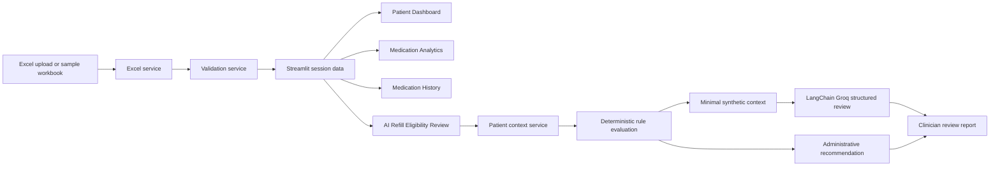

# RxInsight - Medication Analytics & History

RxInsight is a synthetic, safety-aware Streamlit application for exploring patient medication data, refill timing, allergies, and medication history. It includes an advisory AI Refill Eligibility Review workflow designed for administrative support and authorized clinician review.

> This project uses fictional data only. It is not clinical decision support and does not authorize, approve, reject, prescribe, or dispense medication.

## Features

- Upload and validate `.xlsx` workbooks with four related worksheets.
- Load or download a fictional sample workbook.
- Patient Dashboard with filters, KPI cards, CSV export, and patient summaries.
- Medication Analytics with interactive Plotly charts.
- Medication History with date filtering, timelines, event cards, charts, and CSV export.
- AI Refill Eligibility Review as a fourth tab.
- Deterministic refill and administrative review rules.
- Synthetic six-month medication context preparation.
- Advisory LangChain/Groq review using the open-weight `openai/gpt-oss-20b` model.
- Pydantic structured output validation.
- Error handling for missing configuration, API failures, timeouts, and malformed model output.

The original three tabs, Excel upload flow, patient dashboards, charts, filters, and medication history remain intact.

## AI Refill Eligibility Review

The fourth tab lets a user select a synthetic patient and one of that patient's medications. The application collects:

- Diagnosis and documented allergies.
- Medication name, strength, dose, frequency, dates, prescription status, and refills remaining.
- Six months of medication history for the selected medication.

### Deterministic administrative checks

These checks run locally before any AI request and are authoritative:

- Prescription status and discontinued medication.
- Expired prescription.
- Refill due or refill soon timing.
- Refills remaining.
- Required information and missing dates.
- Explicit allergy mappings.
- Unsupported allergy checks.

The UI displays one administrative recommendation:

- `Administrative information complete` - no configured administrative blocker was detected.
- `Review required` - one or more administrative review flags were detected.
- `Insufficient information` - required data is missing or an allergy check is unsupported.

These statuses never mean clinical eligibility or refill authorization. An authorized clinician must make the final decision.

### AI review behavior

Groq receives only a minimal synthetic context and the deterministic rule results. The AI returns structured fields for:

- Summary.
- Supporting evidence.
- Missing information.
- Review questions for the clinician.
- Administrative review status matching the deterministic status.

The system prompt instructs the model to treat history and notes as untrusted data, avoid unsupported inferences, preserve deterministic rule results, and remain clinician-in-the-loop. Responses containing unauthorized clinical decisions or unsafe action terms are rejected.

If the API is unavailable or the model output is malformed, the application preserves and displays the deterministic results without presenting an AI review.

## Configuration

Never hardcode or commit API keys. `.env` is excluded by [`.gitignore`](.gitignore).

### Environment variable

Create a local `.env` file in the project directory or set the variable in the shell:

```powershell
$env:GROQ_API_KEY = "your-groq-key"
streamlit run app.py
```

The application loads `.env` with `python-dotenv` and does not override an already configured environment variable.

### Streamlit secrets

Alternatively, create `.streamlit/secrets.toml`:

```toml
GROQ_API_KEY = "your-groq-key"
```

If credentials have ever been committed, pasted into chat, or exposed in logs, revoke and rotate them immediately.

## Installation and use

Requires Python 3.11 or newer.

```bash
pip install -r requirements.txt
python scripts/generate_sample_data.py
streamlit run app.py
pytest
```

Using `uv`:

```bash
uv sync
uv run streamlit run app.py
uv run pytest
```

From the repository root, the equivalent module command is:

```bash
streamlit run src/rxdashboard/app.py
```

To demonstrate the AI workflow:

1. Launch the application.
2. Open **AI Refill Eligibility Review**.
3. Select a synthetic patient and current medication.
4. Review the deterministic administrative recommendation and flags.
5. Expand the synthetic context if needed.
6. Select **Run AI administrative review**.
7. Review the summary, evidence, missing information, and clinician questions.
8. Change the patient or medication to start a fresh review.

## Architecture



## Project services

- `src/rxdashboard/services/excel_service.py` - Workbook loading and export.
- `src/rxdashboard/services/validation_service.py` - Workbook schema and relationship validation.
- `src/rxdashboard/services/medication_service.py` - Existing medication status calculations.
- `src/rxdashboard/services/allergy_service.py` - Explicit demonstration allergy mappings.
- `src/rxdashboard/services/summary_service.py` - Patient summary generation.
- `src/rxdashboard/services/refill_review.py` - Synthetic context, deterministic rules, Groq/LangChain integration, Pydantic validation, audit-safe logging, and report generation.

## Workbook format

The workbook contains these worksheets:

- `Patients`
- `Medications`
- `Medication History`
- `Allergies`

Required columns and relationships are defined in `src/rxdashboard/config.py`. The loader reports missing sheets or columns, duplicate identifiers, invalid dates, negative numeric values, and broken patient or medication relationships without crashing the app.

## Testing

The test suite covers existing dashboard services and the refill-review workflow, including:

- Missing required data.
- Expired prescriptions.
- Zero refills remaining.
- Discontinued medications.
- Unsupported allergy checks.
- API failures and timeouts.
- Malformed LLM output.
- Unsafe terms in structured model fields.
- Administrative recommendation statuses.
- Existing pagination, allergy, status, sample-data, and workbook validation behavior.

Run tests with:

```bash
pytest
```

## Safety limitations

All data is fictional. The application does not connect to a pharmacy, EHR, FHIR server, or prescribing system. Refill timing is an informational administrative calculation based on expected fill dates. Allergy results are limited to explicitly configured demonstration pairs; unknown medication/allergen relationships are marked `Not Evaluated` and are not clinical clearance.

The LLM is not permitted to approve, reject, prescribe, change doses, determine clinical eligibility, or override deterministic rules. Any real-world refill action requires review and authorization by an appropriately authorized clinician.
